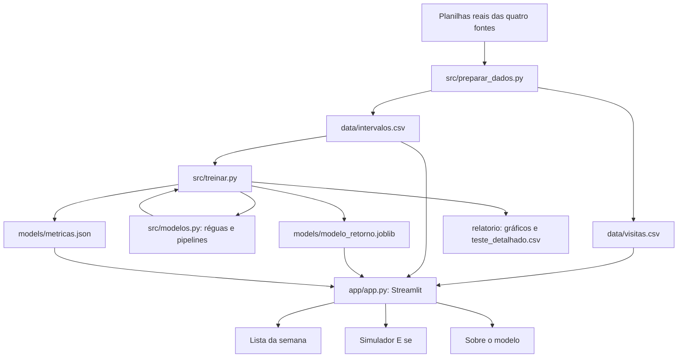

# Arquitetura — Retorno Inteligente

## Objetivo
Apoiar a priorização de contatos de clientes que já realizaram trocas de óleo, **sem confundir a previsão de retorno com o vencimento técnico da manutenção**.

## Separação de responsabilidades

| Componente | Responsabilidade | Limite |
|---|---|---|
| `src/preparar_dados.py` | Unificar, limpar e formar intervalos entre trocas | Não deve usar a data final do intervalo para calcular as features de entrada |
| `src/modelos.py` | Réguas, pré-processamento, modelos e custos ilustrativos | Uma previsão de retorno não é uma recomendação mecânica |
| `src/treinar.py` | Validação temporal, comparação, seleção, avaliação, artefatos | Teste final não deve orientar uma nova seleção de hiperparâmetros |
| `app/app.py` | Carregar artefatos e mostrar decisões | Não treina modelos e não envia contatos automaticamente |
| `tests/` | Verificar regras e regressões conhecidas | Testes não substituem validação estatística do ML |

## Dados e limites do MVP
- Entrada: arquivos Excel pseudonimizados; não coletar nomes, CPFs, placas ou telefones no protótipo.
- Saída: previsão em dias, faixa de incerteza, prioridade de contato e simulações.
- Modelos disponíveis: régua selecionada na validação e melhor regressão treinada.
- O aplicativo não possui, nesta versão, cadastro de usuários, autenticação por oficina, envio automatizado de lembretes ou integração com sistemas externos.
- A avaliação principal usa dobras em ordem da data final; a checagem temporal estrita é mais próxima da disponibilidade real dos dados na data inicial.

## Reprodutibilidade
1. `pip install -r requirements.txt`
2. `python executar_tudo.py`
3. `python -m streamlit run app/app.py`
4. Não usar os exemplos do teste final para retunar modelos ou regras.
