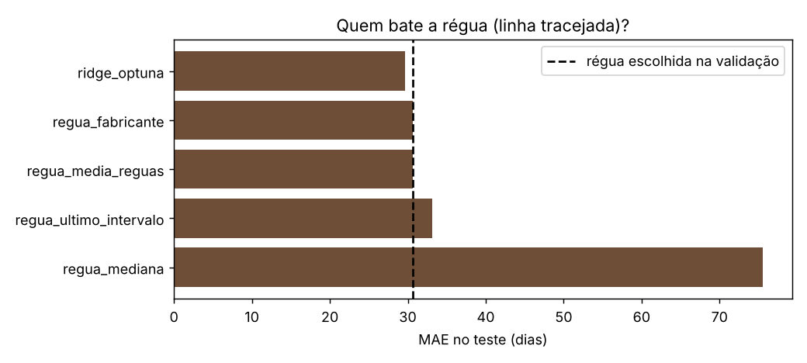
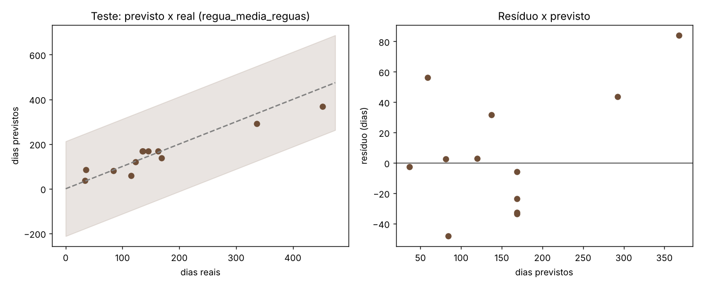
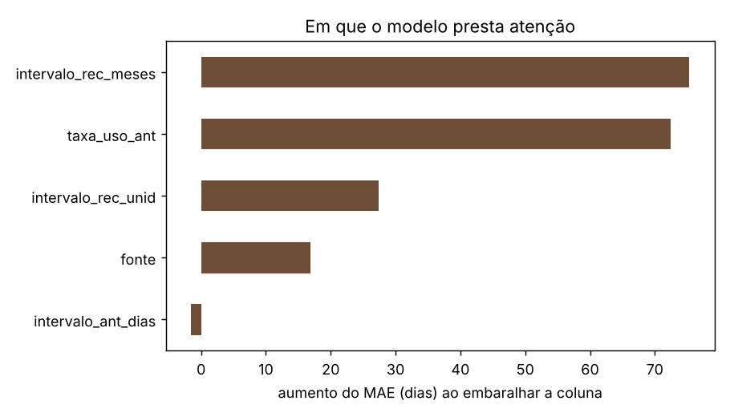

# Relatório: Retorno Inteligente, previsão de retorno à oficina para troca de óleo

Nanodegree de IA & ML da Atitus
Grupo: Arthur Risson, Vitor Pires, Nathalia de Souza, Gabriela Ampese, Leonardo Cambrussi, Isadora Aguirre

Solução de Machine Learning (regressão supervisionada) construída e avaliada **só com dados reais** de três oficinas mecânicas e uma frota municipal. O relatório segue as 11 etapas da aula 4 do curso. Cada etapa termina com um parágrafo em texto respondendo à pergunta dela.

## 0. Por que o tema mudou

O pré-projeto aprovado previa estimar a receita de motoristas de aplicativo. Não conseguimos nenhuma base real de jornadas de motoristas, e o histórico de corridas dos integrantes como passageiros tinha poucas linhas. O professor orientou a não usar dados gerados. Trocamos para um problema com dados reais ao alcance do grupo (oficinas da família e vizinhas), mantendo toda a estrutura de código já construída: pipeline de preparo, divisão temporal, comparação com réguas, modelo salvo, testes automatizados e aplicação em Streamlit.

## 1. Problema

**Pergunta da oficina:** quais clientes devo contatar esta semana para a troca de óleo?

Hoje o lembrete segue uma regra igual para todos ("10.000 km ou 12 meses"). Dois carros iguais têm ritmos de uso muito diferentes: na nossa base há um Mobi de aplicativo que roda 140 km por dia e volta a cada 90 dias, e um Santana que roda 5.000 km por ano e volta pelos 12 meses. O sistema aprende o ritmo de cada veículo e prevê a data de retorno.

Custo de cada erro: lembrar **tarde** (o carro já voltou ou trocou em outro lugar) perde o serviço; lembrar **cedo demais** gasta um contato que o cliente ignora.

*Resposta da etapa:* a decisão é "ligar ou não ligar para este cliente esta semana", e o erro mais caro é o atraso.

## 2. Dados

### 2.1 Fontes

| Fonte | Origem | Linhas | Veículos |
|---|---|---|---|
| Cirocar (Tapejara/RS) | NF-e emitidas pela oficina, nov/2020 a nov/2026 | 420 | 207 |
| Oficina Mecânica Ampese (São Domingos do Sul/RS) | fichas e etiquetas da oficina | 35 | 9 |
| Oficina vizinha (Lica / Matheus Ampese) | ordens de serviço do sistema | 8 | 4 |
| Prefeitura de São Domingos do Sul | relatórios do sistema de frotas (máquinas, em horas) | 12 | 7 |

Todas pseudonimizadas: código no lugar de placa, nome, CPF e telefone. Nenhum dado pessoal entra no repositório.

### 2.2 O que está faltando

Na Cirocar, 203 das 420 notas não têm km anotado e quase nenhuma tem ano do carro, tipo de óleo ou uso. A Ampese preencheu tudo, inclusive o intervalo recomendado por veículo. A prefeitura mede em horas de horímetro e anota a próxima troca prevista. O preparo trata isso com imputação pela mediana mais uma coluna indicadora de "estava vazio" (aula 4).

### 2.3 Unidade de treino: o intervalo

Um exemplo é o trecho entre duas trocas de óleo consecutivas do mesmo veículo, ambas com leitura. Regra de limpeza do serviço: conta como troca de óleo toda linha que começa com "troca de óleo" (com ou sem filtros); as demais visitas não contam como troca, mas suas leituras entram no cálculo do ritmo de uso.

| Situação | Regra | Quantidade |
|---|---|---|
| válido | 0 < km rodados ≤ 15.000 (ou ≤ 600 h) e ≤ 730 dias | **59** |
| perdida | acima desses limites: provável troca em outro lugar no meio | 37 |
| erro | km que volta ou dias ≤ 0 | 2 |

**Os limites são uma hipótese de tratamento, não uma comprovação.** Não temos confirmação individual de que esses 37 veículos trocaram óleo em outro lugar; os valores (15.000 km, 600 h, 730 dias) vieram da experiência da Cirocar e do fato de nenhum fabricante recomendar mais de 12 meses. Intervalos acima deles foram tratados como potencialmente incompletos. Essa escolha influencia os resultados: com limites mais frouxos entrariam intervalos muito longos, que são justamente os mais incertos. Os registros descartados como intervalo ainda alimentam o cálculo do ritmo de uso.

Os 59 intervalos válidos vêm de 31 veículos: Cirocar 30 (15 veículos, mediana 88 dias e 10.350 km), Ampese 21 (9 veículos, mediana 187 dias e 5.400 km), Lica 3, Prefeitura 5 (mediana 145 dias e 261 horas).

Features, calculadas **só com o que se sabia na data da troca anterior** (sem vazamento, conferido por teste automatizado): ritmo de uso (unidades por dia desde a primeira leitura do veículo), intervalo anterior em dias e em unidades, número de trocas anteriores, idade do veículo, a conta da regra do fabricante com os dados do próprio carro (`dias_regra`), tipo de óleo, unidade (km ou h), uso, aplicativo, frota e fonte. Intervalo recomendado: o informado pela oficina ou, se vazio, o padrão por tipo de óleo (mineral 5.000 km/6 meses, semissintético 7.500/12, sintético 10.000/12; máquinas 250 h/6).

*Resposta da etapa:* temos poucas dezenas de exemplos, com muitas células vazias na maior fonte. É um estudo dessas oficinas, não uma base para generalizar.

## 3. Separação

Intervalos ordenados pela data da troca seguinte. **Teste final: os últimos 20% (12 intervalos, de 03/09 a 30/10/2026), trancados até a etapa 8.** Treino: 47 intervalos de 26 veículos, até 07/08/2026. O pré-processamento aprende só dentro do `Pipeline`.

**Validação cruzada temporal (aula 5), com janela que expande.** Os 47 intervalos do treino, em ordem de data, são divididos em 5 blocos cronológicos. O bloco k é a validação e o treino são todos os blocos anteriores: dobras de 10 → 10, 20 → 9, 29 → 9 e 38 → 9 (treino → validação). Nenhum intervalo de treino termina depois do fim de um intervalo de validação (conferido por `assert` no código e por teste automatizado). É a mesma regra do teste final, então validação e teste medem a mesma coisa. 37 dos 47 intervalos recebem previsão fora da dobra; os 10 primeiros só treinam.

Limitação reconhecida: a validação oficial corta pela data de fim dos intervalos. Um intervalo de treino de outro veículo pode ter terminado depois do início de um intervalo de validação; na prática, naquele momento, ele ainda não estaria concluído. A variante estrita abaixo corrige isso e chegou à mesma conclusão (régua 84,2 contra Ridge 85,4), por isso a reconhecemos como limitação sem reestruturar o projeto.

Duas outras validações foram rodadas só para comparação, sem decidir nada: uma **estrita** (o treino do bloco k são apenas os intervalos que já tinham terminado antes do início do primeiro intervalo do bloco; dobras 20 → 9, 22 → 9, 27 → 9) e a **embaralhada** (`KFold` com `shuffle`, nossa primeira versão, que deixava intervalos do futuro ajudarem a prever o passado e foi substituída depois da revisão do grupo).

O mesmo veículo pode aparecer no treino e no teste porque, na prática, o sistema é usado com clientes conhecidos. As features de cada intervalo usam só visitas anteriores à sua data de início, então o resultado de um intervalo nunca entra como informação de outro.

## 4. Linhas de base (as réguas)

Cinco réguas, todas em dias, avaliadas na validação temporal:

| Régua | Como prevê | MAE validação (dias) |
|---|---|---|
| Regra cega do fabricante (como a oficina faz hoje) | todo carro volta nos meses recomendados, sem olhar o km | 175,8 |
| Mediana do treino | todo intervalo dura a mediana | 86,7 |
| Repete o último intervalo | o mesmo que o carro levou da última vez (sem histórico, mediana da fonte) | 79,2 |
| Fabricante personalizado (a ideia do grupo) | min(km recomendado ÷ **km por dia deste carro**, meses × 30,4); sem ritmo de uso, mediana da fonte ou da unidade, senão só os meses | 72,9 |
| **Média das duas anteriores** | média entre fabricante personalizado e último intervalo | **63,1** |

*Resposta da etapa:* a régua cega, que é o lembrete que a oficina manda hoje, erra 176 dias. Personalizar pelo ritmo de uso derruba para 73; juntar com o hábito do cliente, para 63. Essa é a régua que os modelos de regressão precisam bater.

## 5. Preparo

`ColumnTransformer` com três receitas: colunas com valores enormes (ritmo de uso, km do último intervalo) recebem imputação pela mediana com indicador, logaritmo e padronização; as demais numéricas, imputação com indicador e padronização; categóricas, imputação pelo mais frequente e one-hot com `handle_unknown="ignore"`. Antes do preparo, um transformador acrescenta ao exemplo as previsões das duas réguas, ajustadas só no treino de cada dobra (**empilhamento**): o modelo aprende a correção sobre a regra e sobre o hábito do cliente.

Três conjuntos de features para a ablação da aula 2: `reguas` (só as duas previsões das réguas), `basico` (+ ritmo de uso, intervalo anterior, regra do fabricante, tipo de óleo, unidade) e `completo` (+ idade, km anterior, uso, aplicativo, frota, fonte).

## 6. Modelos

`LinearRegression`, `RidgeCV`, `LassoCV` e `ElasticNetCV` (alphas em `logspace(-2, 3, 60)`, aula 2) em cada conjunto, mais um alvo alternativo (km até a próxima troca convertido em dias pelo ritmo de uso).

| Modelo (validação temporal) | MAE (dias) |
|---|---|
| Ridge, conjunto `basico` | 63,1 |
| Ridge, `reguas` | 65,0 |
| Ridge, `completo` | 65,1 |
| ElasticNet / Lasso, `basico` | 67,2 a 67,5 |
| ElasticNet / Lasso, `reguas` | 69,3 a 71,3 |
| ElasticNet / Lasso, `completo` | 73,2 a 80,4 |
| Linear, `reguas` | 73,9 |
| Ridge sobre km convertido em dias | 90,7 |
| Linear, `basico` | 92,6 |
| Linear, `completo` | 160,9 |

*Resposta da etapa:* a regularização segura o estrago (o linear sem freio com todas as colunas erra 161 dias, o Ridge com as mesmas colunas 65), como a aula 2 demonstra com colunas de ruído. Mas nenhum modelo passa da melhor régua: o Ridge básico empata com ela em 63,1.

## 7. Ajuste fino

Optuna (`TPESampler(seed=42)`, 40 tentativas) escolhendo o alpha do Ridge (log, 1e-3 a 1e3), o conjunto de features e o alvo (dias ou log dos dias), sempre pela média da validação temporal, sem tocar no teste. Melhor tentativa: alpha 1,53, conjunto `reguas`, alvo log(dias), MAE 64,9. Gráfico em `optuna.png`.

Critério de escolha do modelo final, definido antes de olhar o teste: menor MAE na validação; em empate (menos de 0,5 dia de diferença), a opção mais simples. **Vencedora: a média das réguas (63,1), empatada com o Ridge básico (63,1).** O sistema entrega os dois lado a lado.

## 8. Prova final

Aberta uma única vez, com os modelos reajustados no treino inteiro:

| No teste (12 intervalos) | MAE (dias) | RMSE | MAPE | R² |
|---|---|---|---|---|
| Fabricante personalizado | 30,6 | 38,8 | 27,1% | 0,886 |
| **Média das réguas (escolhida na validação)** | **30,6** | 39,0 | 26,3% | 0,884 |
| Repete o último intervalo | 33,2 | 44,9 | 27,7% | 0,847 |
| Ridge básico (melhor ML) | 34,0 | 46,3 | 42,8% | 0,838 |
| Mediana do treino | 75,5 | 121,5 | 64,4% | −0,119 |
| Regra cega do fabricante (hoje) | 127,5 | 177,3 | 219,1% | −1,384 |





**Caso a caso** (`teste_detalhado.csv`): o erro mediano do Ridge é menor (20 dias) que o da regra escolhida (32), mas um único intervalo da Cirocar (36 dias reais, 148 previstos) custa 112 dias de erro ao Ridge e puxa a média. A regra erra menos nos extremos e mais no meio. Com 12 casos, um exemplo muda o placar.

Faixa de previsão (aula 1): resíduo típico s = 106 dias na validação temporal, faixa ±212 dias, que cobriu 100% dos 12 casos do teste. A faixa é larga porque a base mistura carros de aplicativo que voltam em 60 dias com carros de passeio que voltam em 365; é honesta, não é útil para o cliente individual, e por isso a lista da semana mostra a data prevista e a faixa juntas.

*Resposta da etapa:* no teste, a regra personalizada e a média das réguas empatam em 31 dias; o Ridge faz 34; a regra cega que a oficina usa hoje faz 127. O erro no teste foi menor que o da validação (31 contra 63), mas, com só 12 intervalos, não dá para concluir que o modelo está livre de sobreajuste: o período de teste (retornos recentes de clientes fiéis da Ampese e da prefeitura) pode simplesmente ser mais fácil de prever. O que se sustenta é: o ML não mostrou vantagem consistente sobre a regra personalizada em nenhuma das três validações nem no teste; a melhoria grande veio da personalização pelo ritmo de uso.

## 9. Explicação

Importância por permutação (20 repetições, aumento do MAE em dias ao embaralhar a coluna) no melhor modelo de ML, o Ridge básico:

| Coluna | Aumento do MAE |
|---|---|
| ritmo de uso (unidades por dia) | +32,9 |
| intervalo recomendado (meses) | +23,4 |
| intervalo anterior (dias) | +17,2 |
| intervalo recomendado (km ou h) | +14,2 |
| fonte | +12,9 |
| unidade (km ou h) | +10,7 |
| regra do fabricante calculada | +3,8 |
| tipo de óleo, nº de trocas | ≈ 0 |



*Resposta da etapa:* o modelo presta atenção primeiro em quanto o carro roda por dia, depois no teto de meses do fabricante e no hábito do cliente. É o que o mecânico faria de cabeça. Importância não é causa.

## 10. Decisão

O modelo estima a data. A oficina decide **com quantos dias de antecedência** mandar o lembrete. Com as previsões fora da dobra da validação temporal (nunca o teste), calculamos para cada antecedência de 0 a 60 dias o custo total: lembrete que chegou depois do retorno (perda do serviço) mais lembrete mais de 45 dias antes do retorno (contato à toa).

**Os custos são hipotéticos**: R$ 150 pelo serviço perdido e R$ 15 pelo contato foram escolhidos pelo grupo para demonstrar o mecanismo, não medidos nas oficinas. O que importa é que a antecedência sai dos custos, e muda quando eles mudam.


Com esses valores, a melhor antecedência é **55 dias** antes da data prevista. Se o contato custar R$ 75 (cinco vezes mais), cai para 14 dias. A curva é plana entre 45 e 60 dias: qualquer valor nessa região custa quase o mesmo.

*Resposta da etapa:* como o erro mais caro é o atraso, vale lembrar cedo. Quando o contato encarece, a antecedência diminui. O número certo depende das contas de cada oficina, que ela mesma coloca no sistema.

## 11. Simulação

Função `simular` copia um veículo, troca ritmo de uso, tipo de óleo, aplicativo ou intervalo recomendado e pede nova previsão. No app, controles deslizantes mostram a previsão mudando. O que o simulador mostra é o que o modelo prevê, não o que acontece se a oficina mudar alguma coisa.

## 12. O que o sistema prevê, e o que não prevê

Há duas perguntas diferentes. **Quando o óleo deve ser trocado** depende da recomendação técnica do fabricante, do km e do tempo: isso é a regra cadastrada, não é previsto. **Quando o cliente provavelmente volta** depende do ritmo de uso e do comportamento observado nas oficinas: isso é o que o sistema prevê. A regra personalizada estima o retorno a partir do ritmo de uso e da recomendação; o Ridge tenta corrigir essa estimativa com o histórico de retornos. Por isso o status no app é "retorno previsto ultrapassado", e não "vencido": o sistema não determina o vencimento técnico do óleo.

## 13. Do notebook ao sistema

`models/modelo_retorno.joblib` guarda a regra escolhida, o melhor modelo de ML (pipeline completo) e o resíduo típico. `app/app.py` carrega o artefato e nunca treina. Páginas: **Lista da semana** (previsão, faixa, data do lembrete, status, filtro de clientes sumidos, origem de cada número), **Simulador** e **Sobre o modelo**.

## 14. Testes

19 testes automatizados (`pytest`): regra de serviço; lista de exclusão; unidade em horas e marcação de frota; intervalo válido, perdido (por km e por dias) e erro; features sem vazamento com datas calculadas à mão; réguas com resultado calculado à mão; regra cega; dobras temporais sem vazamento (treino sempre termina antes da validação); pipeline aceita categoria desconhecida; métricas e resíduo; custo por antecedência; artefato carrega, prevê e simula; registro do split temporal; dobras estritas não usam resultados futuros; réguas sem histórico usam o limite em meses ou a mediana da fonte. Execução ponta a ponta (`python executar_tudo.py`) rodando do zero em menos de 30 segundos. O GitHub roda tudo isso a cada commit.

## 15. Objetivos alcançados e não alcançados

| Objetivo | Situação |
|---|---|
| Base real, documentada, com origem e limitações | **Alcançado** (4 fontes, pseudonimizadas) |
| Réguas e regressões comparadas com separação temporal e validação cruzada temporal | **Alcançado** |
| Ajuste fino sem olhar o teste (Optuna) | **Alcançado** |
| Lembrete personalizado melhor que a regra cega do fabricante | **Alcançado**: erro de 176 para 63 dias na validação e de 127 para 31 no teste |
| Modelo de ML que supera a melhor régua personalizada | **Não alcançado**: empate na validação (63,1 contra 63,1) e desvantagem no teste (34 contra 31) |
| Explicação, decisão por custo e simulação | **Alcançado** |
| Aplicação demonstrável e testes automatizados | **Alcançado** |
| Módulos de freios, suspensão, palhetas | **Não iniciado**, extensões planejadas |

## 16. Limitações

- Base pequena (59 intervalos), concentrada em duas oficinas; uma fonte em horas. Resultado é um estudo dessas oficinas.
- A validação temporal valida 37 intervalos e o teste tem 12: as diferenças de poucos dias entre os três primeiros colocados estão dentro do ruído. Nenhuma conclusão sobre sobreajuste é possível com esse tamanho.
- O critério de "troca perdida" é uma hipótese de tratamento; não temos confirmação individual.
- Só entram veículos que voltaram: o sistema prevê o retorno de clientes que voltam, não quando o óleo precisa ser trocado.
- Km informado pode conter erro; leituras impossíveis foram descartadas e isso é documentado.
- Os custos da decisão são ilustrativos.
- A variável gênero, cogitada na proposta inicial, foi descartada: sem relação causal com a troca de óleo e dado sensível. Usamos comportamento real (ritmo de uso, hábito).
- Com poucos exemplos, a fórmula personalizada feita à mão empatou com a regressão. Isso é um resultado, não um defeito: é a terceira lição da aula 5. O ganho grande está em personalizar pelo ritmo de uso; a regressão refina pouco por cima disso.

## 17. O que mudou depois da revisão do grupo

A primeira versão usava `KFold` embaralhado na validação. A revisão apontou que isso deixava intervalos do futuro ajudarem a prever o passado. Trocamos pela validação temporal com janela que expande e rodamos a estrita como checagem. Efeito: os erros de validação subiram para todos (a embaralhada era otimista), a ordem entre os primeiros mudou pouco, e a conclusão se manteve: personalizar vence a regra cega por muito; ML e régua personalizada empatam. Também passamos a reportar a tabela caso a caso do teste, a declarar os custos como hipotéticos, o critério de troca perdida como hipótese, e a separar "quando trocar" de "quando o cliente volta".

| Validação | Regra cega | Fabricante personalizado | Média das réguas | Ridge básico |
|---|---|---|---|---|
| Embaralhada (antes) | 189,8 | 52,6 | 52,7 | 66,7 |
| Temporal, janela que expande (oficial) | 175,8 | 72,9 | 63,1 | 63,1 |
| Temporal estrita (checagem) | 141,5 | 89,8 | 84,2 | 85,4 |

## 18. Próximos passos

1. Obter mais intervalos reais (cada carro com etiqueta de óleo que entra na oficina vira um).
2. Reavaliar com 150 ou mais intervalos: é o tamanho em que a aula 4 mostra o modelo estabilizando.
3. Separar por veículo (não só por data) para medir generalização a clientes novos.
4. Pedir às oficinas os custos reais de serviço perdido e de contato.
5. Módulos de freios e palhetas como extensões.

## 19. Reprodução

```
pip install -r requirements.txt
python executar_tudo.py --app
```

## 20. Roteiro da demonstração

1. `specs.md`, seção 2: a pergunta da oficina e o custo de cada erro.
2. `python src/preparar_dados.py`: mostrar as células vazias e a contagem de intervalos válidos, perdidos e erro.
3. `python src/treinar.py`: as dobras temporais, a tabela da validação (réguas em preto, modelos em marrom), a escolha, a prova final e a importância.
4. `pytest`: 19 testes.
5. App, Lista da semana: mudar a antecedência e ver a lista de "contatar agora" mudar; alternar regra e ML.
6. App, Simulador: pegar o Mobi de aplicativo (AMPESE_V004, 139 km/dia), baixar o ritmo de uso para 20 km/dia e ver a previsão mudar.
7. App, Sobre o modelo: placar, faixa, decisão por custo, limitações.
8. Fechar com a tabela de objetivos alcançados e não alcançados.
