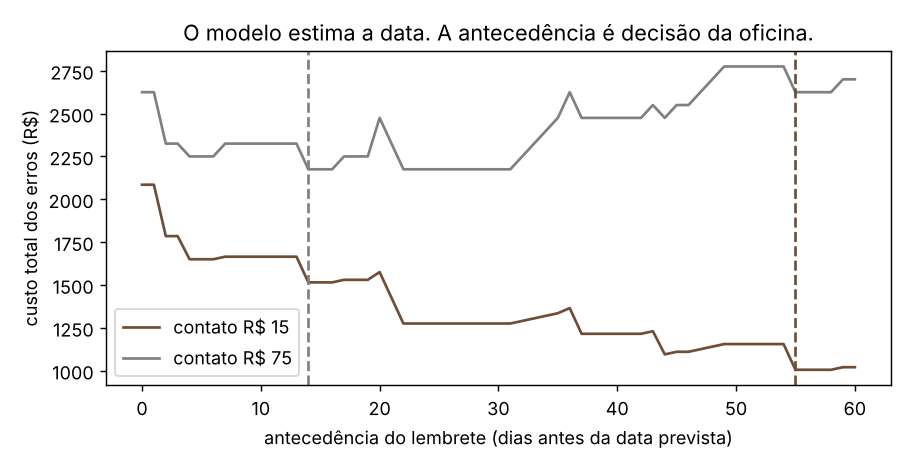

# Relatório: Retorno Inteligente, previsão de retorno à oficina para troca de óleo

Nanodegree de IA & ML da Atitus
Grupo: Arthur Risson, Vitor Pires, Nathalia de Souza, Gabriela Ampese, Leonardo Cambrussi, Isadora Aguirre

Solução de Machine Learning (regressão supervisionada) construída e avaliada **só com dados reais** de três oficinas mecânicas e uma frota municipal. O relatório segue as 11 etapas da aula 4 do curso. Cada etapa termina com um parágrafo em texto respondendo à pergunta dela.

## 0. Por que o tema mudou

O pré-projeto aprovado previa estimar a receita de motoristas de aplicativo. Não conseguimos nenhuma base real de jornadas de motoristas, e o histórico de corridas dos integrantes como passageiros tinha poucas linhas. O professor orientou a não usar dados gerados. Trocamos para um problema com dados reais ao alcance do grupo (oficinas da família e vizinhas), mantendo toda a estrutura de código já construída: pipeline de preparo, divisão temporal, comparação com réguas, modelo salvo, testes automatizados e aplicação em Streamlit.

## 1. Problema

**Pergunta da oficina:** quais clientes devo contatar esta semana para a troca de óleo?

Hoje o lembrete segue uma regra igual para todos ("10.000 km ou 12 meses"). Dois carros iguais têm ritmos de uso muito diferentes: na nossa base há um Mobi de aplicativo que roda 140 km por dia e volta a cada 90 dias, e um Santana que roda 5.000 km por ano e volta pelos 12 meses. O sistema aprende o ritmo de cada veículo e prevê a data de retorno.

Custo de cada erro: lembrar **tarde** (o carro já voltou ou trocou em outro lugar) perde o serviço; lembrar **cedo demais** gasta um contato que o cliente ignora.

*Resposta da etapa:* a decisão é "ligar ou não ligar para este cliente esta semana", e o erro mais caro é o atraso.

## 2. Dados

### 2.1 Fontes

| Fonte | Origem | Linhas | Veículos |
|---|---|---|---|
| Cirocar (Tapejara/RS) | NF-e emitidas pela oficina, nov/2020 a nov/2026 | 420 | 207 |
| Oficina Mecânica Ampese (São Domingos do Sul/RS) | fichas e etiquetas da oficina | 35 | 9 |
| Oficina vizinha (Lica / Matheus Ampese) | ordens de serviço do sistema | 8 | 4 |
| Prefeitura de São Domingos do Sul | relatórios do sistema de frotas (máquinas, em horas) | 12 | 7 |

Todas pseudonimizadas: código no lugar de placa, nome, CPF e telefone. Nenhum dado pessoal entra no repositório.

### 2.2 O que está faltando

Na Cirocar, 203 das 420 notas não têm km anotado e quase nenhuma tem ano do carro, tipo de óleo ou uso. A Ampese preencheu tudo, inclusive o intervalo recomendado por veículo. A prefeitura mede em horas de horímetro e anota a próxima troca prevista. O preparo trata isso com imputação pela mediana mais uma coluna indicadora de "estava vazio" (aula 4).

### 2.3 Unidade de treino: o intervalo

Um exemplo é o trecho entre duas trocas de óleo consecutivas do mesmo veículo, ambas com leitura. Regra de limpeza do serviço: conta como troca de óleo toda linha que começa com "troca de óleo" (com ou sem filtros); as demais visitas não contam como troca, mas suas leituras entram no cálculo do ritmo de uso.

| Situação | Regra | Quantidade |
|---|---|---|
| válido | 0 < km rodados ≤ 15.000 (ou ≤ 600 h) e ≤ 730 dias | **59** |
| perdida | acima desses limites: houve troca em outro lugar (critério informado pela Cirocar) | 37 |
| erro | km que volta ou dias ≤ 0 | 2 |

Os 59 intervalos válidos vêm de 31 veículos: Cirocar 30 (15 veículos, mediana 88 dias e 10.350 km), Ampese 21 (9 veículos, mediana 187 dias e 5.400 km), Lica 3, Prefeitura 5 (mediana 145 dias e 261 horas).

Features, calculadas **só com o que se sabia na data da troca anterior** (sem vazamento, conferido por teste automatizado): ritmo de uso (unidades por dia desde a primeira leitura do veículo), intervalo anterior em dias e em unidades, número de trocas anteriores, idade do veículo, a conta da regra do fabricante com os dados do próprio carro (`dias_regra`), tipo de óleo, unidade (km ou h), uso, aplicativo, frota e fonte. Intervalo recomendado: o informado pela oficina ou, se vazio, o padrão por tipo de óleo (mineral 5.000 km/6 meses, semissintético 7.500/12, sintético 10.000/12; máquinas 250 h/6).

*Resposta da etapa:* temos poucas dezenas de exemplos, com muitas células vazias na maior fonte. É um estudo dessas oficinas, não uma base para generalizar.

## 3. Separação

Intervalos ordenados pela data da troca seguinte. **Teste final: os últimos 20% (12 intervalos, de 03/09 a 30/10/2026), trancados até a etapa 8.** Treino: 47 intervalos de 26 veículos, até 07/08/2026. No treino, validação cruzada com 5 dobras (aula 4) para escolher tudo. O pré-processamento aprende só dentro do `Pipeline`.

O mesmo veículo pode aparecer no treino e no teste porque, na prática, o sistema é usado com clientes conhecidos.

## 4. Linhas de base (as réguas)

Quatro réguas, todas em dias, avaliadas na validação cruzada:

| Régua | Como prevê | MAE validação (dias) |
|---|---|---|
| Regra cega do fabricante (como a oficina faz hoje) | todo carro volta nos meses recomendados, sem olhar o km | 189,8 |
| Mediana do treino | todo intervalo dura 121 dias | 91,2 |
| Repete o último intervalo | o mesmo que o carro levou da última vez (sem histórico, mediana da fonte) | 63,6 |
| Média das duas seguintes | média entre fabricante personalizado e último intervalo | 52,7 |
| **Fabricante personalizado (a ideia do grupo)** | min(km recomendado ÷ **km por dia deste carro**, meses × 30,4); sem ritmo de uso, mediana da fonte ou da unidade, senão só os meses | **52,6** |

*Resposta da etapa:* a régua cega, que é o lembrete que a oficina manda hoje, erra 190 dias. Só de dividir o km do fabricante pelo ritmo real de cada carro o erro cai para 53. Essa fórmula é a ideia central do grupo e é a régua que os modelos de regressão precisam bater.

## 5. Preparo

`ColumnTransformer` com três receitas: colunas com valores enormes (ritmo de uso, km do último intervalo) recebem imputação pela mediana com indicador, logaritmo e padronização; as demais numéricas, imputação com indicador e padronização; categóricas, imputação pelo mais frequente e one-hot com `handle_unknown="ignore"`. Antes do preparo, um transformador acrescenta ao exemplo as previsões das duas réguas, ajustadas só no treino de cada dobra (**empilhamento**): o modelo aprende a correção sobre a regra e sobre o hábito do cliente, em vez de ter que redescobri-los com 47 exemplos.

Três conjuntos de features para a ablação da aula 2: `reguas` (só as duas previsões das réguas), `basico` (+ ritmo de uso, intervalo anterior, regra do fabricante, tipo de óleo, unidade) e `completo` (+ idade, km anterior, uso, aplicativo, frota, fonte).

## 6. Modelos

`LinearRegression`, `RidgeCV`, `LassoCV` e `ElasticNetCV` (alphas em `logspace(-2, 3, 60)`, como na aula 2) em cada conjunto, mais um alvo alternativo (km até a próxima troca convertido em dias pelo ritmo de uso).

| Modelo (validação cruzada) | MAE (dias) |
|---|---|
| ElasticNet / Ridge / Lasso, conjunto `reguas` | 56,9 a 57,3 |
| Linear, `reguas` | 60,6 |
| Lasso / ElasticNet / Ridge, `basico` | 65,4 a 66,7 |
| ElasticNet / Lasso / Ridge, `completo` | 67,3 a 71,3 |
| Ridge sobre km convertido em dias | 68,5 |
| Linear, `basico` | 81,5 |
| Linear, `completo` | 153,5 |

*Resposta da etapa:* quanto mais colunas, pior. O conjunto só com as réguas é o melhor; o `completo` sem regularização estoura (MAE 153), exatamente o sobreajuste que a aula 2 demonstra com colunas de ruído. Padronizar e regularizar segurou o estrago, mas não fez o modelo vencer a régua.

## 7. Ajuste fino

Optuna (`TPESampler(seed=42)`, 40 tentativas) escolhendo o alpha do Ridge (log, 1e-3 a 1e3), o conjunto de features e o alvo (dias ou log dos dias), sempre pela média da validação cruzada, sem tocar no teste. Melhor tentativa: alpha 0,001, conjunto `reguas`, alvo log(dias), MAE 56,8. Gráfico em `optuna.png`.

Critério de escolha do modelo final: menor MAE na validação cruzada entre réguas e modelos. **Vencedora: a regra do fabricante personalizada (52,6).** Melhor modelo de ML: Ridge do Optuna sobre as réguas, alvo log (56,8). A diferença de 4 dias em 47 exemplos está dentro do ruído, então o sistema entrega os dois lado a lado.

## 8. Prova final

Aberta uma única vez, com os modelos reajustados no treino inteiro:

| No teste (12 intervalos) | MAE (dias) | RMSE | MAPE | R² |
|---|---|---|---|---|
| Ridge do Optuna sobre as réguas (melhor ML) | **29,6** | 34,4 | 36,3% | 0,910 |
| Fabricante personalizado (escolhido na validação) | 30,6 | 38,8 | 27,1% | 0,886 |
| Média das réguas | 30,6 | 39,0 | 26,3% | 0,884 |
| Repete o último intervalo | 33,2 | 44,9 | 27,7% | 0,847 |
| Mediana do treino | 75,5 | 121,5 | 64,4% | −0,119 |
| Regra cega do fabricante (hoje) | 127,5 | | | |


Faixa de previsão (aula 1): resíduo típico s = 85,8 dias na validação, faixa ±172 dias, que cobriu 100% dos 12 casos do teste (a faixa é larga porque a base mistura carros de aplicativo que voltam em 60 dias com carros de passeio que voltam em 365).

*Resposta da etapa:* no teste, o modelo de ML foi o melhor (29,6 dias), seguido de perto pela regra personalizada (30,6) e pelo hábito (33,2). A regra cega que a oficina usa hoje erra 127 dias nos mesmos 12 casos: o sistema reduz o erro em quatro vezes. O erro de teste (30 dias) foi menor que o de validação (53), sinal de que não houve decoreba, mas também de que 12 exemplos são poucos para separar os três primeiros: tratamos ML e regra personalizada como empate.

## 9. Explicação

Importância por permutação (20 repetições, aumento do MAE em dias ao embaralhar a coluna) no melhor modelo de ML:

| Coluna | Aumento do MAE |
|---|---|
| intervalo recomendado (meses) | +75,3 |
| ritmo de uso (unidades por dia) | +72,4 |
| intervalo recomendado (km ou h) | +27,4 |
| fonte | +16,9 |
| intervalo anterior (dias) | −1,6 |


*Resposta da etapa:* o modelo presta atenção no teto de meses do fabricante e em quanto o carro roda por dia (os dois lados da conta "km recomendado ÷ km por dia, limitado pelos meses"). O hábito do cliente quase não acrescenta depois disso. É o que o mecânico faria de cabeça. Importância não é causa.

## 10. Decisão

O modelo estima a data. A oficina decide **com quantos dias de antecedência** mandar o lembrete. Com as previsões fora da dobra no treino (`cross_val_predict`, nunca o teste), calculamos para cada antecedência de 0 a 60 dias o custo total: lembrete que chegou depois do retorno (perda do serviço, R$ 150) mais lembrete mais de 45 dias antes do retorno (contato à toa, R$ 15).



Melhor antecedência: **60 dias** antes da data prevista. Se o contato custar R$ 75 (cinco vezes mais), cai para 23 dias. A curva é plana entre 45 e 60 dias: qualquer valor nessa região custa quase o mesmo.

*Resposta da etapa:* como o erro mais caro é o atraso, vale lembrar cedo. Quando o contato encarece, a antecedência diminui. O número certo depende das contas da oficina, não do modelo.

## 11. Simulação

Função `simular` copia um veículo, troca ritmo de uso, tipo de óleo, aplicativo ou intervalo recomendado e pede nova previsão. No app, controles deslizantes mostram a previsão mudando. O que o simulador mostra é o que o modelo prevê, não o que acontece se a oficina mudar alguma coisa.

## 12. Do notebook ao sistema

`models/modelo_retorno.joblib` guarda a regra escolhida, o melhor modelo de ML (pipeline completo) e o resíduo típico. `app/app.py` carrega o artefato e nunca treina. Páginas: **Lista da semana** (previsão, faixa, data do lembrete, status, filtro de clientes sumidos, origem de cada número), **Simulador** e **Sobre o modelo**.

## 13. Testes

14 testes automatizados (`pytest`): regra de serviço; lista de exclusão; unidade em horas e marcação de frota; intervalo válido, perdido (por km e por dias) e erro; features sem vazamento com datas calculadas à mão; réguas com resultado calculado à mão; pipeline aceita categoria desconhecida; métricas e resíduo; custo por antecedência; artefato carrega, prevê e simula; registro do split temporal. Execução ponta a ponta (`preparar_dados.py` → `treinar.py` → `pytest` → `streamlit run`) rodando do zero em menos de 30 segundos.

## 14. Objetivos alcançados e não alcançados

| Objetivo | Situação |
|---|---|
| Base real, documentada, com origem e limitações | **Alcançado** (4 fontes, pseudonimizadas) |
| Réguas e regressões comparadas com separação temporal e validação cruzada | **Alcançado** |
| Ajuste fino sem olhar o teste (Optuna) | **Alcançado** |
| Lembrete personalizado melhor que a regra cega do fabricante | **Alcançado**: erro de 190 para 53 dias na validação e de 127 para 30 no teste |
| Modelo de ML que supera a melhor régua personalizada | **Empate**: 56,8 contra 52,6 na validação; 29,6 contra 30,6 no teste |
| Explicação, decisão por custo e simulação | **Alcançado** |
| Aplicação demonstrável e testes automatizados | **Alcançado** |
| Módulos de freios, suspensão, palhetas | **Não iniciado**, extensões planejadas |

## 15. Limitações

- Base pequena (59 intervalos), concentrada em duas oficinas; uma fonte em horas. Resultado é um estudo dessas oficinas.
- Só entram veículos que voltaram: o sistema prevê o retorno de clientes que voltam, não quando o óleo precisa ser trocado.
- Km informado pode conter erro; leituras impossíveis foram descartadas e isso é documentado.
- A variável gênero, cogitada na proposta inicial, foi descartada: sem relação causal com a troca de óleo e dado sensível. Usamos comportamento real (ritmo de uso, hábito).
- Com poucos exemplos, a fórmula personalizada feita à mão empatou com a regressão. Isso é um resultado, não um defeito: é a terceira lição da aula 5. O ganho grande está em personalizar pelo ritmo de uso; a regressão refina pouco por cima disso.

## 16. Próximos passos

1. Continuar a coleta nas três oficinas (cada carro que entra com etiqueta de óleo vira um intervalo real).
2. Reavaliar com 150 ou mais intervalos: é o tamanho em que a aula 4 mostra o modelo estabilizando.
3. Separar por veículo (não só por data) para medir generalização a clientes novos.
4. Módulos de freios e palhetas como extensões.

## 17. Reprodução

```
pip install -r requirements.txt
python src/preparar_dados.py
python src/treinar.py
pytest
streamlit run app/app.py
```

## 18. Roteiro da demonstração

1. `specs.md`, seção 2: a pergunta da oficina e o custo de cada erro.
2. `python src/preparar_dados.py`: mostrar as células vazias e a contagem de intervalos válidos, perdidos e erro.
3. `python src/treinar.py`: a tabela da validação cruzada (réguas em preto, modelos em marrom), a escolha, a prova final e a importância.
4. `pytest`: 13 testes.
5. App, Lista da semana: mudar a antecedência e ver a lista de "contatar agora" mudar; alternar regra e ML.
6. App, Simulador: pegar o Mobi de aplicativo (AMPESE_V004, 139 km/dia), baixar o ritmo de uso para 20 km/dia e ver a previsão ir de 72 para 365 dias na regra personalizada (88 para 462 no ML, que extrapola um pouco além do teto do fabricante).
7. App, Sobre o modelo: placar, faixa, decisão por custo, limitações.
8. Fechar com a tabela de objetivos alcançados e não alcançados.
